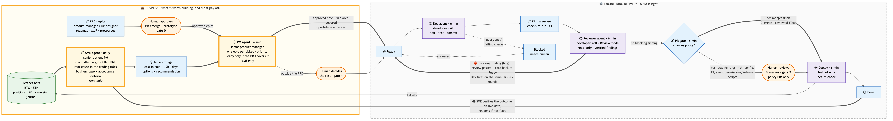

# Agentic development

This bot is developed by a small team of AI agents with a person in charge. One agent watches the running bots and reports problems as GitHub issues. Another turns approved issues into tested pull requests, and a third reviews each of those pull requests and sends it back until its findings are fixed. A deploy step ships what I merge to testnet, and the first agent checks the next day that the fix worked. I decide what gets built and what gets merged: **the agents propose, a person approves.**

Everything happens in the open on GitHub, so each step can be audited: the [project board](https://github.com/users/rchau73/projects/1), the issues labelled [`agent:sme`](https://github.com/rchau73/optionsBot/issues?q=label%3Aagent%3Asme) and the pull requests labelled [`agent:dev`](https://github.com/rchau73/optionsBot/pulls?q=label%3Aagent%3Adev).



## The loop

| # | Step | Who | What happens |
|---|---|---|---|
| ① | **Find** | SME agent, daily | Reads the testnet bots' state, events, trades and P&L, plus its own previous reports. Finds issues (freezes, idle margin, one-sided books, bad fills, stops) and tuning opportunities. |
| ② | **Report** | script | Opens one GitHub issue per finding on the **Triage** column, with evidence and acceptance criteria. A finding seen again becomes a comment, not a duplicate. |
| ③ | **Triage** | **me — gate 1** | I refine the issue: scope, constraints, acceptance criteria. Then I move the good ones to **Ready**. |
| ④⑤ | **Build** | Dev agent, every 15 min | Takes the oldest Ready issue and implements it on its own branch, in an isolated worktree, with tests and docs. Then it commits. |
| ⑥ | **Verify & propose** | script | Re-runs every check itself (gofmt, vet, race tests, frontend lint/test/build), pushes, and opens a PR that closes the issue → **In review**. If checks fail, or the agent stops with questions → **Blocked**, with the questions on the issue. |
| ⑦ | **Review** | Reviewer agent, every 15 min | Reviews each new commit of a Dev agent PR as a second engineer: correctness, the trading rules, whether every acceptance scenario has a real test. It checks each finding against the code before reporting it, then posts one review with inline comments. A **blocking** finding moves the card back to **Ready**, and the Dev agent fixes it on the same PR and answers each finding in the PR body. After 2 fix rounds a person decides. No blocking finding → the PR is labelled `agent:reviewed`. So when I open a PR, the review loop has already run. |
| ⑧ | **Review & merge** | **me — gate 2** | GitHub requires a PR with green CI for `main`. I read the agent's review and the code, and merge, or request changes: moving the card back to Ready makes the Dev agent address my review on the same PR. |
| ⑨⑩ | **Deploy** | script, every 15 min | When `main` moves, it rebuilds and restarts the **testnet** containers and checks that every bot's decision loop reports again. Then it moves the card to **Done**. |
| ⑪ | **Verify the fix** | SME agent, next day | Checks the closed issue's acceptance criteria against fresh data. It comments "fixed", or reopens the issue to Triage. |

## What a ticket looks like

Every SME issue follows one template, written so someone with little context on the project can **approve or reject it from the ticket alone**:

1. **In one line:** the problem and its cost.
2. **User story:** *As an investor, I want …, so that …*
3. **Business problem:** what it costs, in coin, USD, idle days or risk.
4. **Business rules involved:** the rule as the bot applies it today, why it exists, and where it falls short. Jargon is defined on first use.
5. **What happened (data):** a timestamped table of what the bot saw, did and got.
6. **Proposed solution:** the steps, the alternatives considered (including *do nothing*), and effort and risk.
7. **Metrics:** baseline, target, and where each is measured.
8. **Acceptance criteria** in Gherkin (`Given … When … Then …`), including at least one scenario that protects what must not change. The Dev agent turns each scenario into a test, and the SME agent checks them against live data after the deploy.
9. **Decision needed:** *Go if … · Reject if …*, with a recommendation.

## The agents

| | SME agent | Dev agent | Reviewer agent | Deploy |
|---|---|---|---|---|
| Brain | Claude Code with the [option-bot-specialist](.claude/skills/option-bot-specialist/SKILL.md) skill: a senior options PM | Claude Code with the [developer](.claude/skills/developer/SKILL.md) skill: a senior Go + React engineer | the same developer skill in its *Review mode*, in a separate run that did not write the code | none (a script) |
| Trigger | daily, launchd | every 15 min, a card in **Ready** | every 15 min, an `agent:dev` PR in **In review** with an unreviewed commit | every 15 min, `main` moved |
| Can | **read** the collected data and the docs | read/edit files, run build/test/lint, `git add`/`commit` | **read** the code at the PR head, run build/vet/test | `git pull --ff-only`, `docker compose up`, move cards |
| Cannot | run commands, edit anything, use the network or MCP tools | push, call GitHub, use the network, docker, `rm`, `git reset`/`checkout`; merge or deploy | edit, commit, push, call GitHub, use the network; approve or merge | deploy live; touch a checkout that isn't a clean `main` |
| Output | a report + a findings block → issues | commits + a PR body → a PR | a findings block → one PR review; card → Ready or stays for a person | containers restarted, cards → Done |

The agents' permissions are enforced by Claude Code, not by prompting: `--permission-mode dontAsk` with explicit allowed and denied tool lists ([`sme_review.sh`](scripts/agents/sme_review.sh), [`dev_agent.sh`](scripts/agents/dev_agent.sh), [`review_agent.sh`](scripts/agents/review_agent.sh)). Anything not on the allowed list is refused. Every GitHub action is taken by the shell script around the agent, after its own checks, never by the model itself.

## Guardrails

- **Human gates at the two decisions that matter:** what to build (Triage → Ready) and what ships (merge). No agent can merge: a ruleset on `main` requires a pull request with green CI and blocks force pushes and branch deletion.
- **Least privilege:** the agent that looks at trading data cannot change code, and the agent that changes code cannot see the network or GitHub.
- **Trust, but verify:** the Dev agent's "tests pass" is not taken at its word. The script re-runs every check, and a failing PR is opened as a draft and blocked. Then a separate Reviewer agent reads the change with no stake in it, and must back each finding with a concrete failure: an unverified first pass on PR #91 had 3 false findings out of 10.
- **Bounded review loop:** the Reviewer sends a PR back at most twice (`REVIEW_MAX_ROUNDS`), reviews each commit once, and a failed review hands the PR to a person instead of retrying. Its review is a comment, not an approval: the agents use my GitHub login, which can't approve its own PR, so the board column carries the decision and merging stays mine.
- **Testnet only:** automatic deploys refuse to run if any bot is live. Live deploys stay manual.
- **Data exposure:** this repo is public. On testnet, issues carry full evidence, because the money is fake. If a bot runs live, the SME agent is told to leave balances, sizes and P&L out of issues; the full report stays local (`data/sme/`, gitignored).
- **Stop instead of guessing:** the Dev agent stops when an issue is ambiguous, needs a product decision, or would change live order behaviour beyond what the issue says. It posts its questions and moves the card to **Blocked**.
- **Idempotent and bounded:** one Dev task at a time, with locks and stale-lock recovery. Issues are de-duplicated by a stable fingerprint. A failed deploy commit is not retried in a loop.
- **Audit trail:** every agent action is an issue, a comment, a commit or a PR, labelled `agent:*`, with its run log in `data/agents/`. Each pickup comment numbers the attempt and says what came before (blocked, sent back by the Reviewer, or a person's comment), so an issue tells its whole story even when a card was moved back on the board.

## How AI is used in this repo beyond the loop

- **Project memory.** [`CLAUDE.md`](CLAUDE.md) records the architecture and every rule *with the incident that caused it* (dates, coins, numbers). New work, by a person or an agent, starts from what already went wrong.
- **Two expert personas as skills.** The [developer](.claude/skills/developer/SKILL.md) skill brings engineering judgement: plan first, tests and logs by default, simple code, guard rails. The [option-bot-specialist](.claude/skills/option-bot-specialist/SKILL.md) skill brings trading judgement: risk before return, hypotheses tested in backtests, P&L with market context. The same skills drive interactive sessions and the unattended agents.
- **Rules backed by evidence.** Strategy rules are compared with `cmd/stress` replays before they change, and the numbers go in the PR.

## Example

On 2026-10-15 the ETH bot sat flat for days, frozen by a DVOL band change that could not move its IM limit: under a confirmed negative gamma regime the limit is pinned to the lowest band either way. The fix ([#79](https://github.com/rchau73/optionsBot/pull/79)) was built in an interactive session. Later that day, the SME agent's first unattended review flagged the same problem on its own, with the same diagnosis and fix, plus three new findings: BTC GEX sheds whipsawing on an unstable flip, short-DTE slots with no expiry for 31 h, and an unmanaged long put on the account. That is the loop this workflow automates.

## Run it

```bash
gh auth refresh -s project            # once: the board needs the project scope
scripts/agents/setup_github.sh        # once: labels, project board, ruleset on main
scripts/agents/install.sh             # launchd: SME daily at 09:00; deploy, review, Dev every 15 min
launchctl kickstart gui/$(id -u)/com.optionsbot.sme-review   # run a review now
scripts/agents/install.sh --uninstall
```

Runs on the Mac that runs the bots, logged in to Claude Code and `gh`. Logs: `data/sme/<date>/` (reports, collected data) and `data/agents/` (dev runs, reviews, deploys, launchd).

## Trade-offs and next steps

- **One GitHub identity.** The agents act with my `gh` login, so the separation of duties is enforced by tool permissions and the ruleset, not by GitHub identity. Next step: a GitHub App or a machine user for the agents, with "require one approval" on `main`, so GitHub itself enforces that someone other than the author approves.
- **One machine.** The bots, the monitor and the agents run on one Mac (launchd catches up after sleep). Moving the bots to a server would move the agents with them; moving only the Dev agent to GitHub Actions is possible, but deploy and the SME agent need the bots' local API.
- **Measure the agents.** Track issues opened → triaged → merged → verified fixed, review rounds per PR, findings I overrule, and PRs reverted, to see whether the agents earn their keep.

---

*Educational study of an automated trading system — not investment advice. Options trading can lose more than the premium collected; crypto markets are highly volatile.*
